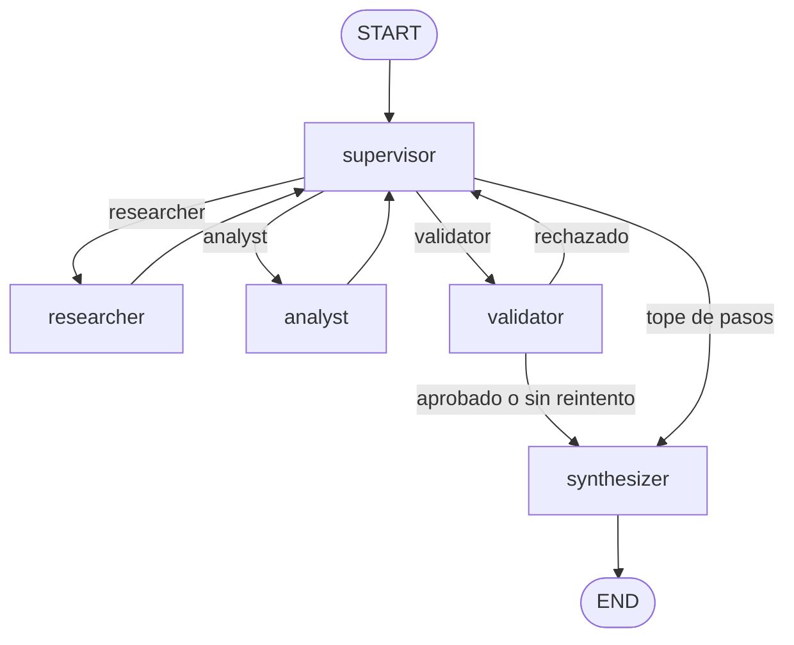

# Entrega de código del módulo 6 | Orquestador multi-agente jerárquico

Orquestador asíncrono en LangGraph para una pregunta que necesita dos tipos de trabajo: investigación en la web pública y después un juicio sobre esas notas (sentimiento o aritmética). Un supervisor enruta la pregunta. El investigador busca con Tavily. El analista puntúa el sentimiento o evalúa una expresión aritmética. Un validador revisa los dos artefactos, y un sintetizador escribe la respuesta.

Esta entrega usa búsqueda web en vivo. No consulta una base vectorial.

## Grafo

Ver la imagen `graph-diagram.png`.



1. La pregunta del usuario se guarda en un `OrchestratorState` nuevo. No se recarga nada de una pregunta anterior.
2. `supervisor` lee la pregunta, las notas de investigación, las notas de análisis, el último error y el feedback de validación. Devuelve `next_agent: Literal["researcher", "analyst", "validator"]` más una instrucción corta. Ese literal es la arista condicional.
3. `researcher` corre un agente ReAct cuya única herramienta es `web_search`. El estado padre recibe un resumen, no la transcripción de las herramientas.
4. `analyst` corre un agente ReAct cuyas únicas herramientas son `score_sentiment` y `calculate`. Ve las notas de investigación y la instrucción del supervisor.
5. `validator` es determinista. Acepta una nota de investigación con fuentes junto con un juicio de sentimiento o numérico. También acepta un hueco explícito: la nota de investigación está marcada con `NO_RELIABLE_SOURCES` y la nota de análisis termina con `JUDGMENT: insufficient`.
6. `synthesizer` escribe la respuesta para el usuario a partir de esas dos notas y termina el grafo. No tiene herramientas.

`max_supervisor_steps` (6 por defecto) cuenta las visitas al supervisor. En la visita que alcanza el tope, la arista condicional va a `synthesizer` aunque el modelo haya pedido otro especialista. `recursion_limit` (25 por defecto) es el tope exterior.

## Por qué esta topología

Se elije esta topologia porque la direccion del flujo es directa/determinista y no se puede paralelizar y se requiere de un lugar unico final para responderle al usuario final.

El supervisor es el único router. El investigador y el analista vuelven a él y no se llaman entre sí, así que un resultado de búsqueda no puede saltear la rúbrica y un cálculo no puede lanzar otra búsqueda. El validador está en el camino hacia la respuesta, así que un especialista no aprueba sus propias notas. Agregar otro especialista después es un nodo nuevo más un valor nuevo en el `Literal` del supervisor.

Una cadena fija buscaría siempre y después calcularía siempre, también cuando la búsqueda ya volvió vacía. El supervisor elige el siguiente especialista según los artefactos reunidos hasta el momento, y puede reenviar a un especialista cuando el validador nombra un hueco.

## Errores entre agentes

Cada especialista tiene un contexto acotado: la pregunta del usuario, la instrucción del supervisor, el feedback de validación y solo el artefacto que ese especialista necesita. El analista lee `research_notes`. No lee el historial de payloads de Tavily. La lista de mensajes del padre guarda un mensaje corto por agente, así que una llamada posterior no reejecuta cada resultado de herramienta.

Los fallos de herramientas quedan dentro del especialista. `web_search`, `score_sentiment` y `calculate` capturan los errores y devuelven JSON con un campo `error`. El traceback no se guarda. Las API keys se eliminan de ese texto.

El nodo del especialista después controla su propio contrato antes de guardar las notas:

- El investigador tiene que haber llamado a `web_search`, y el resumen tiene que citar una URL `http` o incluir la línea `NO_RELIABLE_SOURCES`.
- Un juicio de sentimiento tiene que venir de una llamada a `score_sentiment`. Un juicio numérico tiene que venir de una llamada a `calculate`. Si no, el nodo guarda `last_error` y deja las notas anteriores en su lugar.

El supervisor puede reenviar a ese especialista una vez (`max_specialist_runs` es 2). El mismo tope se aplica en código, así que un modelo que sigue eligiendo al mismo agente es avanzado. Cuando el validador rechaza el par y todavía hay un reintento, la arista vuelve al supervisor con un feedback que nombra al especialista. Cuando los dos reintentos se gastaron, o se alcanzó el tope de pasos, la arista va al sintetizador. El sintetizador describe el dato que falta y no lo completa.

Una ausencia confirmada es un resultado terminado, no un bucle: `NO_RELIABLE_SOURCES` junto con `JUDGMENT: insufficient` pasa la validación, y la respuesta explica el hueco.

## Requisitos

- Python 3.12, declarado en `pyproject.toml` como `>=3.12,<3.13`
- `TAVILY_API_KEY` para la búsqueda web
- Una API key del proveedor de chat que se llame:
  - `OPENAI_API_KEY` con `-l openai` (el default)
  - `ANTHROPIC_API_KEY` con `-l anthropic`
  - `GEMINI_API_KEY` con `-l gemini`

## Setup

Desde este directorio. `pip install .` verifica la restricción de Python de `pyproject.toml`. `pip install -r requirements.txt` no lo hace.

```bash
python3.12 -m venv .venv
source .venv/bin/activate
python -m pip install --upgrade pip
python -m pip install .
pip install -r requirements.txt
cp .env.dist .env
```

Poné las claves en `.env`. Ese archivo está en el gitignore.

## Estructura del proyecto

| Archivo | Rol |
|------|------|
| `main.py` | Corre el demo o lee preguntas hasta `exit` o `quit` |
| `graph.py` | `StateGraph`, aristas condicionales y formato de la traza |
| `state.py` | `OrchestratorState` y el reducer de contribuciones |
| `agents/supervisor.py` | Decisión de ruteo estructurada y el respaldo de la rúbrica |
| `agents/research_agent.py` | Agente ReAct ligado a `web_search` |
| `agents/analyst_agent.py` | Agente ReAct ligado a `score_sentiment` y `calculate` |
| `agents/validator.py` | Control determinista de los dos artefactos |
| `agents/synthesizer.py` | Respuesta final a partir de los artefactos |
| `agents/markers.py` | Líneas `NO_RELIABLE_SOURCES` y `JUDGMENT` |
| `agents/context.py` | Texto de tarea acotado para un especialista |
| `tools.py` | Búsqueda Tavily, sentimiento por léxico y aritmética por AST |
| `sample.py` | Preguntas del demo |
| `llm.py` | `OpenAIClient`, `AnthropicClient` y `GeminiClient` |
| `factory.py` | Construye el cliente de chat desde `LLMConfig` |
| `schemas.py` | `LLMProvider`, `LLMConfig` y `SupervisorDecision` |
| `settings.py` | Rutas, tope de pasos, límites de recursión y el proveedor por defecto |
| `trace.log` | Traza de ejecución. La CLI y `--demo` agregan cada corrida acá. En el gitignore. `-c` / `--clean` lo trunca. |
| `trace.log.example` | Ejemplo de tracelog de la corrida demo (`python main.py --demo`). |
| `requirements.txt` | Dependencias |
| `pyproject.toml` | Exige Python 3.12 (`>=3.12,<3.13`) |
| `.env.dist` | Plantilla de entorno con secretos vacíos |

## Herramientas

| Herramienta | Agente | Qué devuelve |
|------|-------|-----------------|
| `web_search` | researcher | Resultados JSON con title, url y content de Tavily. Los fallos devuelven `error`. |
| `score_sentiment` | analyst | `label` (`positive`, `negative`, `mixed` o `neutral`) y `score` en [-1, 1] a partir de una lista fija de palabras. |
| `calculate` | analyst | El valor de una expresión aritmética (`+`, `-`, `*`, `/`, `**`, paréntesis). Nombres y llamadas a funciones devuelven `error`. |

## Uso

Correr desde este directorio.

```bash
# Preguntas desde la terminal. exit o quit detiene.
# Cada pregunta arranca desde un estado nuevo.
python main.py

python main.py -l anthropic
python main.py --llm gemini

# Corre sample.py y agrega la traza.
python main.py --demo

# Trunca trace.log y después corre las muestras.
python main.py -c --demo
```

### Demo

`sample.py` hace tres preguntas. Cada una arranca desde un estado nuevo.

1. Cobertura reciente de los últimos resultados trimestrales de NVIDIA y el sentimiento general de esas fuentes. El investigador busca. El analista llama a `score_sentiment`.
2. Los precios actuales de NVIDIA (NVDA) y AMD, y la diferencia porcentual del precio de NVIDIA respecto al de AMD. El analista tiene que llamar a `calculate`.
3. El EBITDA exacto no publicado de la empresa ficticia Nimbus Lunar Mining. La búsqueda no tiene ese dato. La respuesta explica la fuente que falta y no inventa el número.

## Traza

Cada corrida se agrega a `trace.log` (en el gitignore), desde la CLI y desde `--demo`. Una corrida registra la hora, la cantidad de pasos, si la validación pasó, el texto del usuario, cada ruteo del supervisor, el artefacto de cada especialista, el feedback del validador y la respuesta final. `-c` / `--clean` trunca ese archivo primero.

En `trace.log.example` se deja un ejemplo de tracelog de la corrida demo.
